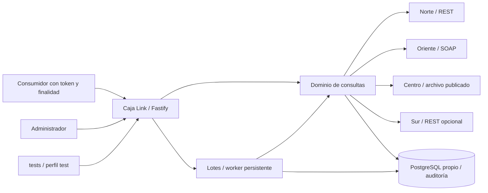

# Arquitectura de Caja Link

## Contexto

Una caja necesita comprobar afiliación vigente en otras organizaciones antes de validar un beneficio. Los orígenes tienen formatos, credenciales, fechas y disponibilidad diferentes. El reto exige autenticación, finalidad, dato mínimo, auditoría, versionado y lotes sin compartir bases externas. Elegimos un hub con adaptadores en Node.js 24, TypeScript estricto, Fastify y PostgreSQL propio. Las cinco operaciones están integradas y la suite repetida aprobó. Una [carga independiente](evidence/load-test.json) verificó 10000 filas sin errores en 62,658 segundos.

## Componentes

Fastify recibe peticiones en el servicio caja-link y valida entradas y salidas mediante esquemas. La seguridad identifica cuatro consumidores y un administrador. El dominio normaliza documentos, calcula vigencia y coordina adaptadores. Norte y Sur usan REST; Oriente usa SOAP; Centro lee la publicación más reciente e indexa solamente los campos necesarios. PostgreSQL guarda migraciones, auditoría, trabajos, resultados e idempotencia persistentes. El worker reutiliza consultas y el servicio tests ejecuta node:test y produce JUnit.

Las cajas simuladas son servicios del kit independientes de la base propia. Caja Link monta únicamente Centro y configuración de solo lectura. Las direcciones y credenciales proceden de entorno y config/cajas.yaml, sin direcciones de cajas escritas en src/. El [arranque limpio](evidence/clean-start.json) exportó 71394a6 con .env.example sin cambios y un volumen PostgreSQL nuevo en otro proyecto Compose. El primer build encontró un timeout TLS de Docker Hub; el segundo construyó y arrancó. El [validador de esa copia](evidence/clean-validator.txt) aprobó P01–P13 y procesó 10000 resultados en 134 segundos, sin sustituir la medición independiente de exactitud.

## Flujo de consulta

La ruta autentica antes de validar el documento y exige identidad consumidora. Verifica una de tres finalidades, elimina puntos, espacios y relleno del documento sin convertirlo a número y captura una fecha de Colombia. Excluye al consumidor antes de consultar orígenes habilitados en paralelo. Los adaptadores devuelven afiliaciones normalizadas o indisponibilidad explícita. El dominio acepta validFrom anterior o igual al corte y validTo nulo o posterior o igual; fechas futuras quedan excluidas.

Una coincidencia vigente produce AFILIADO_OTRA_CAJA, incluso si otras cajas están indisponibles. Sin coincidencias, una falla produce INDETERMINADO; NO_AFILIADO requiere consultas válidas en todos los orígenes necesarios. La auditoría se escribe antes de devolver éxito. La ruta v1 proyecta cinco campos por match; v2 añade affiliateType. ONLINE usa el corte de consulta y FILE conserva FECHA_CORTE.

El POST de lote valida CSV o multipart, finalidad, clave y documentos, persiste el trabajo y devuelve 202. El worker consulta por fila, guarda bloques y reanuda desde el punto confirmado. El GET público devuelve results vacío en PENDING y RUNNING; solamente DONE entrega todas las filas ordenadas. El worker sí puede leer resultados parciales para su recuperación. La clave es única por consumidor y un hash diferente produce 409.

## Manejo de fallas

El presupuesto total configurado es 4500 ms por defecto y admite como máximo 4900 ms. Incluye cola, consulta y auditoría. El presupuesto de orígenes es 3500 ms por defecto y nunca supera el total. Semáforos limitan trabajo global y por origen; señales y deadlines propagan cancelación. Una dependencia que no coopera puede seguir pendiente internamente, pero la espera del consumidor queda acotada y no libera prematuramente su permiso.

Timeout, respuesta corrupta, errores HTTP, SOAP Fault y archivo ausente o ilegible se representan como indisponibilidad. Centro no sirve una publicación anterior para ocultar que la última está corrupta. Una falla o demora indispensable de auditoría produce 503. Errores y logs omiten cuerpos, documentos completos, credenciales y mensajes internos. PostgreSQL reclama trabajos con bloqueo y lease, conserva el avance y recupera trabajos interrumpidos sin exponerlos a otro consumidor.

La primera carga se interrumpió por timeout al consultar estado y reconstruir los resultados acumulados. Se corrigió readResults para que el GET público solicite solamente estado antes de DONE, conservando parciales para el worker. La repetición verificó todas las filas y mantuvo consultas individuales disponibles. La duración aprobada de 62,658 segundos corresponde a la repetición; el intento fallido de 89,011 segundos permanece como evidencia separada.

## Alternativas descartadas

- Integraciones punto a punto entre cada pareja de cajas: multiplican contratos, credenciales y manejo de fallas conforme crece el número de participantes. Un hub permite aplicar la misma política de vigencia, finalidad y auditoría en un lugar, con adaptadores por protocolo.
- Acceso directo a bases externas o copia de los datos internos de simuladores: acopla el servicio a estructuras ajenas y vulnera el límite de acceso del reto. Se usan solamente REST, SOAP y el archivo publicado de Centro.
- Devolver ausencia ante timeout o servir una ausencia cacheada: oculta una fuente sin comprobar y puede autorizar un beneficio indebidamente. Se conserva INDETERMINADO y se vuelve a consultar la fuente para reconocer su recuperación.

El hub concentra disponibilidad y carga; para producción harían falta despliegue redundante, TLS, rotación de secretos, retención y pruebas operativas adicionales. Estas capacidades no se declaran implementadas.
